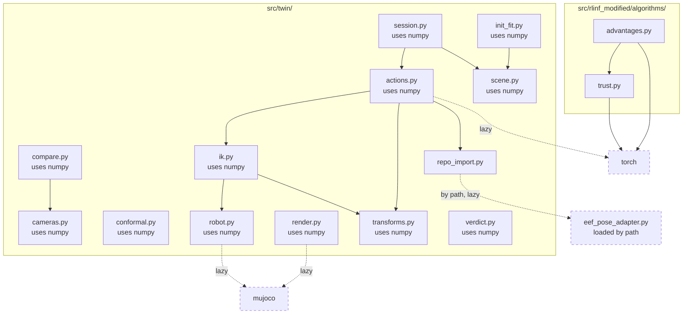
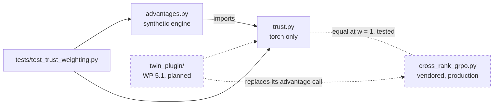
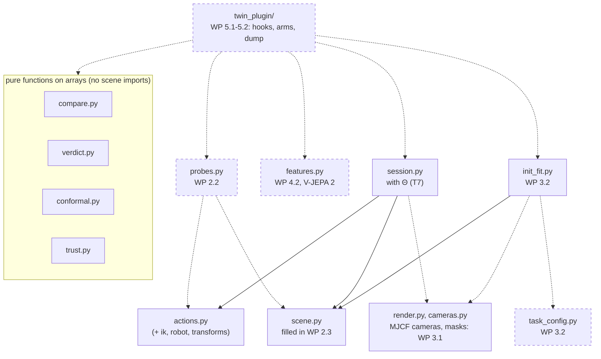

# Dependencies

Which module imports which, for `src/twin/` and the two trust-weighting files. The graph and the
table between the markers are generated from the code by `scripts/make_code_deps.py`, and
`tests/test_docs.py` fails when they are stale: after changing an import, run
`python scripts/make_code_deps.py`.

An arrow A → B means "A imports from B". Dotted arrows are lazy imports (inside a function);
dashed boxes are heavy external libraries or a file loaded by path. numpy is named inside the box
of each module that uses it; the standard library is left out.

<!-- BEGIN GENERATED -->
<!-- Written by scripts/make_code_deps.py; do not edit by hand, rerun the script. -->

| Module | Imports from | Names | When |
|---|---|---|---|
| `rlinf_modified.algorithms.advantages` | `rlinf_modified.algorithms.trust` | `STD_SOURCES`, `StdSource`, `trust_weighted_suffix_advantages` | at import |
| `rlinf_modified.algorithms.advantages` | `torch` | the module | at import |
| `rlinf_modified.algorithms.trust` | `torch` | the module | at import |
| `twin.actions` | `torch` | the module | lazy, in `_repo_rot6d_to_matrix`, `actions_to_eef_targets` |
| `twin.actions` | `twin.ik` | `DEFAULT_IK`, `IKConfig`, `PathIKResult`, `UR5_MAX_JOINT_SPEED`, `track_path` | at import |
| `twin.actions` | `twin.repo_import` | `load_eef_pose_adapter` | at import |
| `twin.actions` | `twin.transforms` | `geodesic_angle`, `invert_T`, `make_T`, `rotvec_to_matrix` | at import |
| `twin.compare` | `twin.cameras` | `PHYSICAL_CAMERAS` | at import |
| `twin.ik` | `twin.robot` | `JOINT_LIMITS`, `TCP_OFFSET`, `UR5_DH`, `dh_transform`, `fk` | at import |
| `twin.ik` | `twin.transforms` | `geodesic_angle`, `invert_T`, `make_T`, `so3_log` | at import |
| `twin.init_fit` | `twin.scene` | `SceneState` | at import |
| `twin.render` | `mujoco` | the module | lazy, in `TwinRenderer.__init__` |
| `twin.repo_import` | `third_party/rlinf_runtime/rlinf/envs/world_model/eef_pose_adapter.py` | the whole file, with `importlib` | lazy, in `load_eef_pose_adapter` |
| `twin.robot` | `mujoco` | the module | lazy, in `load_ur5_model` |
| `twin.session` | `twin.actions` | `ActionsToJoints`, `JointChunk` | at import |
| `twin.session` | `twin.scene` | `ChunkRollout`, `LaptopScene`, `SceneState` | at import |

<!-- END GENERATED -->

## How to read it

- **No import cycles.** Every module imports only from modules that do not import it back
  (`tests/test_docs.py` checks this on the generated graph).
- **Base modules have no internal imports.** `transforms.py` and `robot.py` need only numpy,
  `repo_import.py` only the standard library. `scene.py` and `cameras.py` are skeletons that so far
  mostly define data classes. `verdict.py` and `conformal.py` are numpy only.
- **`ik.py` depends on the robot model**, because IK is FK run backwards and must use exactly the
  same DH table.
- **`actions.py` is the hub of T2.** It is the only module that touches the repo's conversion code
  (through `repo_import.py`), and it hands its result to `ik.py`.
- **`session.py` is the top:** it combines the kinematics (`actions.py`) and the physics
  (`scene.py`) for one environment.
- **The referee maths of Phase 1 stands apart.** `compare.py` imports only the camera names from
  `cameras.py`; `verdict.py` and `conformal.py` import nothing from the package. They are pure
  functions on arrays: they run without the scene, MuJoCo or torch, and nothing calls them yet
  (the plugin will, WP 5.1).
- **Heavy libraries are imported lazily.** `torch` is imported inside `actions_to_eef_targets`
  and `_repo_rot6d_to_matrix` (and needed by the repo file); `mujoco` inside `load_ur5_model` and
  `TwinRenderer.__init__`. So `import twin.ik` works on a machine without torch or MuJoCo, and the
  numpy-only tests run anywhere. `trust.py` and `advantages.py` are torch code and import it at the
  top.

!!! note "Lazy import"
    An `import` written inside a function instead of at the top of the file. It runs only when
    the function is first called. Here it keeps optional, heavy dependencies (torch, MuJoCo, an
    OpenGL context) out of modules that do not always need them.

## Trust weighting and production

The trust-weighting code lives in `src/rlinf_modified/algorithms/`, because it is about the RL
update, not the scene. `trust.py` stands alone; `advantages.py` calls it when `weights` is given;
the plugin (planned) will call it in production, where the tests already show that it equals the
vendored function bit for bit at full trust.

## Where the next work packages plug in

The roadmap's next modules fit into the graph at fixed places (dashed: not in the repo yet).
Building them there keeps the layering: no cycles, heavy imports lazy, the Phase 1 maths free of
scene imports.

| Module | WP | Proposal step and role | Now |
|---|---|---|---|
| `compare.py` | 1.3 | Step 4: change features, D̃, grounded score S and spread κ (on feature arrays) | implemented |
| `verdict.py` | 1.4 | Steps 6.3-6.4: twin decision, Ctrl-World significance, verdict table, p_{i,0} | implemented |
| `conformal.py` | 1.5 | Step 7: conformal threshold, divergence chunk, g_{i,k}; Step 5 calibration rules | implemented |
| `probes.py` | 2.2 | Step 6.2: probe generator and null action, feasibility through `ActionsToJoints` | planned |
| `scene.py` (filled) | 2.3 | Steps 1, 3: laptop physics (T3) | skeleton |
| `cameras.py`, `render.py` (masks) | 3.1 | Steps 1, 3: MJCF cameras, segmentation masks (T4) | skeleton |
| `task_config.py`, `init_fit.py` | 3.2 | Step 2: per-task configuration, render-and-compare fit (T5) | planned, skeleton |
| `features.py` | 4.2 | Step 4: V-JEPA 2 window features φ_t | planned |
| `twin_plugin/` | 5.1-5.2 | integration hooks, arm modes, rollout dump | planned |
