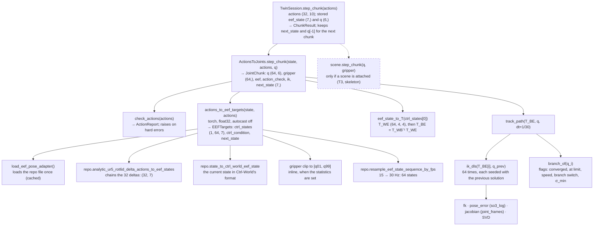
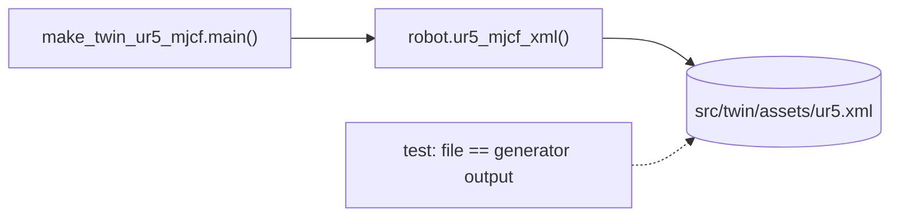
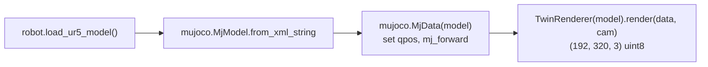
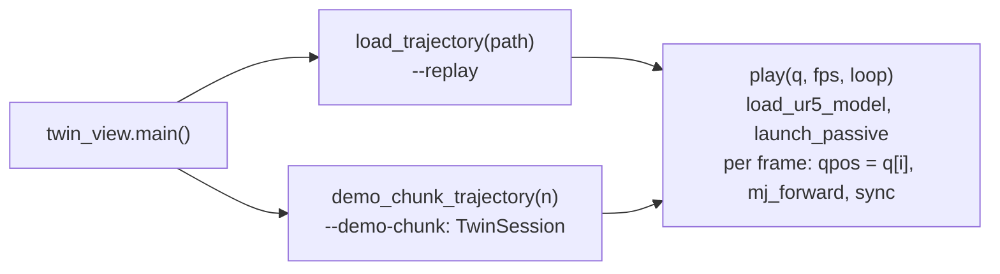
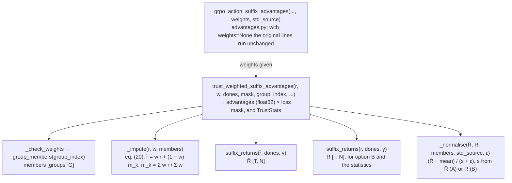
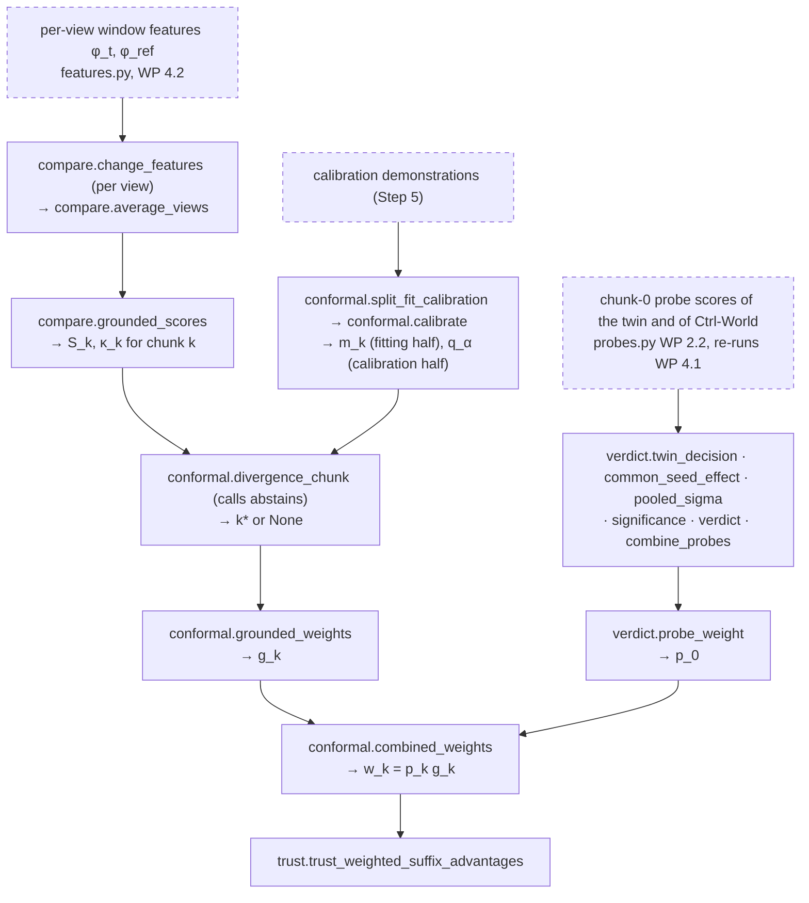
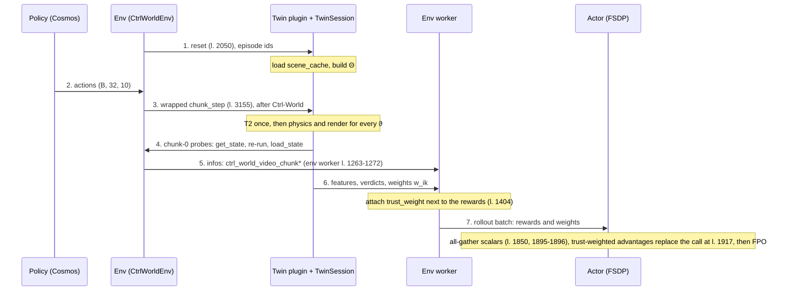

# Call flows

What happens when the code runs. Boxes are functions; an arrow means "calls"; the second line of
a box gives the data passed, with shapes for one chunk. Dashed boxes are not implemented yet.

## One chunk through the twin (today: kinematics only)

The path every chunk will take in training. It is what `TwinSession.step_chunk` runs today; once
T3 exists, the dashed call adds the physics.

`repo.*` are the repo's own functions in `eef_pose_adapter.py`, loaded by path. Two design points
are visible in the call tree:

- **The repo functions are called, not re-implemented.** `actions_to_eef_targets` goes through
  the same three functions as `CtrlWorldEnv._convert_via_analytic_ur5_rot6d` in production, in
  float32, so the twin's 64 targets equal Ctrl-World's conditioning bit for bit.
- **The two pieces of state are chained.** The EEF state for the next chunk is the repo's
  `next_state` (open loop, like Ctrl-World); the IK seed for the next chunk is the last solved
  joint vector. So the arm follows exactly the commanded path; if it cannot, the IK flags say so.

## Model generation, rendering and the viewer

**(a) Generate the model.** The robot model is generated and checked; it is never hand-edited.

**(b) Load and render.** The renderer reads `data` and never changes it.

**(c) The viewer** plays a joint path, from a file or from synthetic chunks run through the twin
(the call tree above).

!!! note "Passive viewer"
    `mujoco.viewer.launch_passive(model, data)` opens a window that *shows* `data` but does not
    step the simulation itself. The script sets `qpos` to the next frame of the path, calls
    `mj_forward` (pose update, no physics), and `viewer.sync()` redraws. It is a kinematic replay,
    which is what is needed to check IK paths.

## Trust-weighted advantages

In production the plugin will call `trust_weighted_suffix_advantages` directly, with the
cross-rank group ids (WP 5.1).

Two implementation details explain the tests. `group_members` gathers each group into a
[T, groups, G] layout that is exactly the reshape the old function used, which is what makes the
w ≡ 1 result *bit*-identical, not just close. And all members enter the mean and std whatever
their loss mask, as in both existing functions; the mask only multiplies the output.

## The referee maths: how the Phase 1 outputs feed each other

The functions of `compare.py`, `verdict.py` and `conformal.py` are tested one by one; nothing
calls them in sequence yet (the plugin will, WP 5.1; an end-to-end test is gap G1 in
`open_items_and_deviations.md`). This is the intended data flow per candidate i, not a call tree.

## The FK reference fixture

`make_twin_fk_reference.main()` calls `load_eef_pose_adapter()` and the repo's
`ur5_joint_actions_to_eef_states` in float64 on 1000 random joint vectors (seed 0), and writes the
inputs and outputs with metadata (source hash, commit) to
`tests/fixtures/twin_fk_reference_ur5.json`. `test_twin_fk.py` compares `robot.fk` with it; a
staleness test regenerates the table when torch is available and fails if the repo function
changed.

## Integration with the training code (planned, WP 5.1)

The vendored runtime in `third_party/` is not edited. The twin will follow the repo's plugin
pattern, `stage15_plugin/`: a `sitecustomize.py` that Python imports at start-up when its folder
is on `PYTHONPATH` (`stage15_plugin/launch_ray_node.sh`, line 89, prepends it on every Ray node).
It does nothing unless an environment variable is set; then it replaces selected runtime
functions (monkeypatching) and fails loudly if that does not work. For the twin:
`twin_plugin/sitecustomize.py`, gated by `RLINF_TWIN_MODE` ∈ {`off`, `log`, `weight`}, and
`RLINF_TWIN_ARM` selecting the training arm (T, T0, TG, S).

Line numbers are those of the current commit (`third_party/` is unchanged since `f4f669e`;
re-checked 26 Nov 2026). Files: env = `third_party/rlinf_runtime/rlinf/envs/world_model/world_model_ctrl_world_env.py`,
env worker = `.../rlinf/workers/env/env_worker.py`, actor = `.../rlinf/workers/actor/fsdp_actor_worker.py`.

1. **Reset** (`CtrlWorldEnv.reset`, line 2050) knows which episode each environment starts from
   (`episode_indices`). The plugin wraps it to reset the matching `TwinSession` from the cache.
2. **Every chunk** (`CtrlWorldEnv.chunk_step`, line 3155) receives the policy's actions
   `[B, chunk, action_dim]` and runs Ctrl-World through `_infer_next_chunk_frames` (line 2747).
   The wrapper calls the original, then steps the twins with the same actions. The subclass
   `CosmosSelfFeedbackCtrlWorldEnv` (line 3589) calls `super().chunk_step` in its own `chunk_step`
   (lines 3696 and 3702), so wrapping the base method covers it (read, not run: check).
3. **Probes at chunk 0** need Ctrl-World to predict again from the same state with another action
   and chosen seeds: `get_state()` (line 3444) serialises the env, including the noise generator
   state; `load_state()` (line 3508) restores it. Whether this restore is exact is assumption M4,
   tested first (WP 4.1).
4. **Ctrl-World's video** leaves the env in `infos` under `ctrl_world_video_chunk`, `_wrist`,
   `_extra` (read in `env_worker.py`, lines 1263-1272; these three keys at 1267-1269). This is
   where the comparison gets V^W.
5. **Weights** travel with the rewards. The actor gathers only *scalar* per-step records across
   ranks (`_compute_cross_rank_grpo_advantages`, line 1716; `all_gather` at lines 1850 and
   1895-1896), because a group of 16 is spread over 4 ranks. The weight becomes one more scalar
   column of that gather, and the trust-weighted function (WP 1.2) replaces the call to
   `validate_and_compute_group_suffix_advantages` (`rlinf/algorithms/cross_rank_grpo.py`,
   line 801; called at line 1917).

**First mode: log only.** In `log` mode the plugin computes everything and logs verdicts, scores,
spreads and weights, but forces w ≡ 1. Its acceptance test is that the advantages are
bit-identical to the baseline. This is also arm A of the proposal (E1, E2): the audit runs on the
original method.
